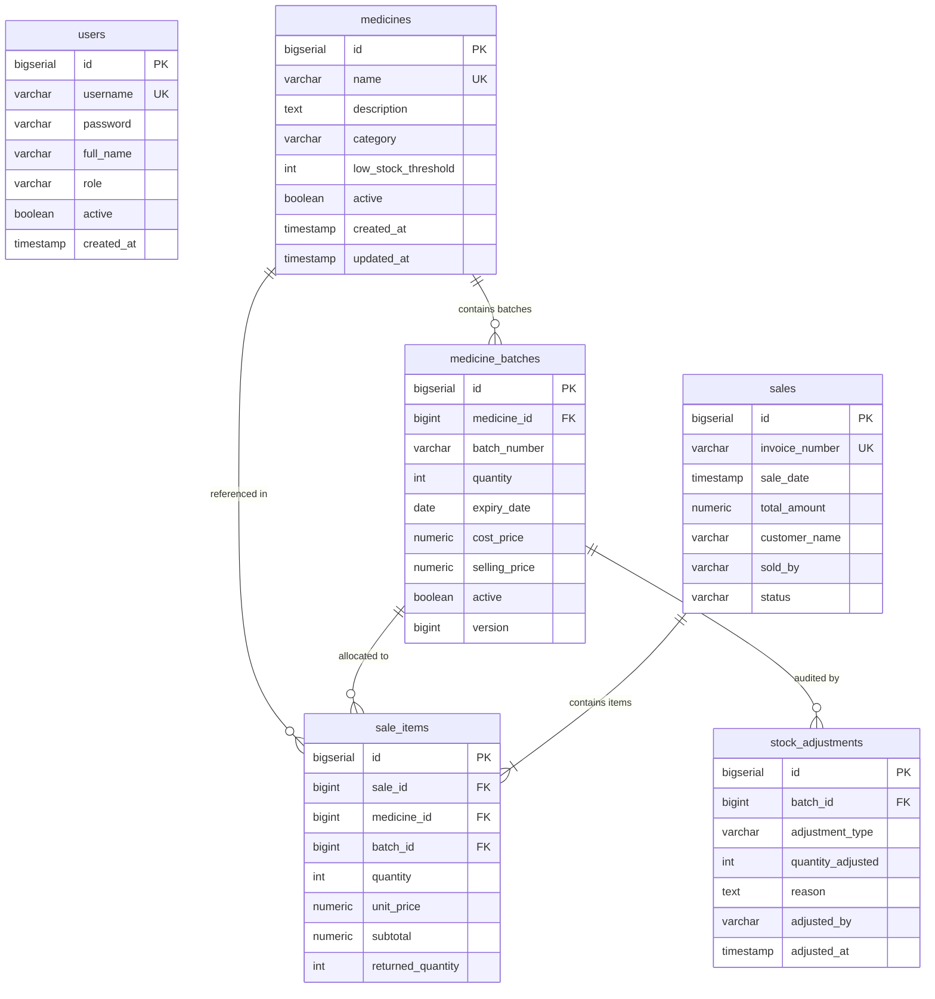

# 💊 Enterprise Pharmacy Inventory & Dispensing System

A production-grade Spring Boot 3.3 REST API for pharmacy inventory management featuring **concurrency-safe FEFO (First-Expired, First-Out) stock deduction**, comprehensive **sales history & batch traceability**, **sales returns**, **stock adjustments & expired stock disposal**, **low-stock & expiry alerts**, **JWT authentication with RBAC**, **Spring Data pagination & sorting**, and **Flyway database migrations**.

---

## 🧠 Core Interview Architecture Highlights

### 1. FEFO (First-Expired, First-Out) vs. FIFO Distinction
> **Why FEFO matters**: In standard warehousing, *FIFO* (First-In, First-Out) selects the goods received earliest. However, in pharmaceutical inventory management, **FEFO** (First-Expired, First-Out) is the regulatory and industry standard. Batches are selected strictly by their **earliest expiry date**, regardless of delivery sequence. This minimizes medication expiration wastage and guarantees patient safety. Our system implements true FEFO deduction at the database and service levels.

### 2. Concurrency-Safe Stock Deduction (Preventing Overselling)
When multiple pharmacists process sales simultaneously for high-demand medicines, concurrent read-modify-write operations can lead to race conditions, inventory drift, and overselling.
- **Pessimistic Locking (`@Lock(LockModeType.PESSIMISTIC_WRITE)`)**: Batches are locked with `SELECT ... FOR UPDATE` during stock queries, preventing concurrent threads from deducting the same batch quantity simultaneously.
- **Optimistic Locking (`@Version`)**: The `MedicineBatch` entity also includes an optimistic locking `@Version` token for defense-in-depth data integrity.
- **Transaction Consistency (`@Transactional(rollbackFor = Exception.class)`)**: Guarantees atomic completion — sale records, batch deduction, allocation mapping, and stock audit logs succeed or roll back together.

### 3. Full Batch Traceability & Sales Return
- Every transaction creates a `Sale` header and granular `SaleItem` rows detailing the exact batch number, unit price, quantity consumed, and expiry date.
- Eligible items can be returned (`POST /api/sales/{id}/return`), atomically restoring inventory quantity to the original batch and recording an audit record in `stock_adjustments`.

---

## 🛠 Tech Stack

| Layer | Technology |
|-------|------------|
| Language | Java 21 |
| Framework | Spring Boot 3.3.5 |
| Security | Spring Security 6, JJWT 0.12.6 (Stateless JWT Authentication) |
| ORM | Spring Data JPA / Hibernate (Pessimistic Locking, `@Version`) |
| Database | PostgreSQL |
| Database Migrations | Flyway (`V1__init_schema.sql`, `V2__seed_initial_data.sql`) |
| Build Tool | Maven |
| API Testing | Postman Collection included |

---

## 🗄 Relational Database Schema



---

## 🔐 Security & Role-Based Access Control (RBAC)

The application uses stateless JWT authentication with token validation filter on every request.

### Pre-Seeded Default Accounts:
| Role | Username | Password | Access Privileges |
|------|----------|----------|-------------------|
| `ROLE_ADMIN` | `admin` | `Admin@123` | Full access: Medicine deactivation/activation, expired stock disposal, stock adjustments, batch and sales management |
| `ROLE_PHARMACIST` | `pharmacist` | `Pharm@123` | Operational access: Sell medicine (FEFO), process sales returns, view alerts, manage batches & medicines |

### Endpoint Authorization Matrix:
| Endpoint Group | Method | Path | Allowed Roles |
|----------------|--------|------|---------------|
| **Auth** | `POST` | `/api/auth/login`, `/api/auth/register` | Public (Permit All) |
| **Medicines** | `GET`, `POST`, `PUT` | `/api/medicines/**` | `ADMIN`, `PHARMACIST` |
| **Medicines** | `PATCH` | `/api/medicines/{id}/deactivate`, `/activate` | `ADMIN` only |
| **Batches** | `GET`, `POST`, `PUT` | `/api/batches/**` | `ADMIN`, `PHARMACIST` |
| **Sales** | `GET`, `POST` | `/api/sales/**` | `ADMIN`, `PHARMACIST` |
| **Returns** | `POST` | `/api/sales/{id}/return` | `ADMIN`, `PHARMACIST` |
| **Alerts** | `GET` | `/api/inventory/alerts/**`, `/api/inventory/expired` | `ADMIN`, `PHARMACIST` |
| **Disposal** | `POST` | `/api/inventory/expired/{id}/dispose` | `ADMIN` only |
| **Adjustments**| `POST`, `GET` | `/api/inventory/adjustments/**` | `ADMIN`, `PHARMACIST` |

---

## ⚙️ Setup & Execution

### 1. Database Configuration
Ensure PostgreSQL is running and database `pharmacy_db` exists:
```sql
CREATE DATABASE pharmacy_db;
```

Update `src/main/resources/application.properties` if needed:
```properties
spring.datasource.url=jdbc:postgresql://localhost:5432/pharmacy_db
spring.datasource.username=postgres
spring.datasource.password=your_password
```

### 2. Flyway Migrations
Database tables and baseline seeds are created automatically at application startup:
- `V1__init_schema.sql`: Creates `users`, `medicines`, `medicine_batches`, `sales`, `sale_items`, `stock_adjustments`.
- `V2__seed_initial_data.sql`: Seeds medicines (Paracetamol, Amoxicillin, Ibuprofen, Cetirizine) and multi-expiry batches.

### 3. Build & Run
```bash
mvn clean compile
mvn spring-boot:run
```
The application will launch on `http://localhost:8080`.

---

## 📡 API Reference & Examples

### 1. Authentication

#### Login (`POST /api/auth/login`)
```json
{
  "username": "pharmacist",
  "password": "Pharm@123"
}
```
**Response**:
```json
{
  "success": true,
  "message": "Authentication successful",
  "data": {
    "token": "eyJhbGciOiJIUzI1NiJ9...",
    "type": "Bearer",
    "username": "pharmacist",
    "role": "ROLE_PHARMACIST",
    "fullName": "Lead Pharmacist"
  }
}
```
> Include the token in subsequent requests header: `Authorization: Bearer <token>`

---

### 2. Concurrency-Safe FEFO Sales

#### Process Sale (`POST /api/sales`)
Executes pessimistic write lock (`SELECT ... FOR UPDATE`) on medicine batches ordered by earliest expiry date.
```json
{
  "customerName": "John Doe",
  "items": [
    {
      "medicineName": "Paracetamol",
      "quantity": 60
    }
  ]
}
```
**Response (FEFO Traceability)**:
```json
{
  "success": true,
  "message": "Sale completed successfully with FEFO batch allocation. Invoice: INV-20261109120000-A1B2",
  "data": {
    "id": 1,
    "invoiceNumber": "INV-20261109120000-A1B2",
    "saleDate": "2026-11-09T12:00:00",
    "totalAmount": 300.00,
    "customerName": "John Doe",
    "soldBy": "pharmacist",
    "status": "COMPLETED",
    "items": [
      {
        "id": 1,
        "medicineName": "Paracetamol",
        "batchNumber": "PARA-BATCH-001",
        "quantity": 50,
        "unitPrice": 5.00,
        "subtotal": 250.00,
        "returnedQuantity": 0,
        "expiryDate": "2026-06-30"
      },
      {
        "id": 2,
        "medicineName": "Paracetamol",
        "batchNumber": "PARA-BATCH-002",
        "quantity": 10,
        "unitPrice": 5.00,
        "subtotal": 50.00,
        "returnedQuantity": 0,
        "expiryDate": "2027-12-31"
      }
    ]
  }
}
```

---

### 3. Sales History & Return

#### View Sales History (`GET /api/sales?page=0&size=10&sort=saleDate,desc`)
Returns paginated sales history with invoice numbers, items, and total amount.

#### Process Return (`POST /api/sales/{saleId}/return`)
Restores stock to the exact batch and records an audit log.
```json
{
  "items": [
    {
      "saleItemId": 2,
      "quantity": 5
    }
  ],
  "reason": "Customer purchased extra quantity by mistake"
}
```
**Response**:
```json
{
  "success": true,
  "message": "Successfully processed return of 5 items for refund amount 25.00",
  "data": {
    "invoiceNumber": "INV-20261109120000-A1B2",
    "status": "PARTIALLY_REFUNDED",
    "totalQuantityReturned": 5,
    "refundAmount": 25.00,
    "message": "Successfully processed return of 5 items for refund amount 25.00"
  }
}
```

---

### 4. Medicine Management (Paginated & Filtered)

#### Create Medicine (`POST /api/medicines`)
```json
{
  "name": "Metformin",
  "description": "Antidiabetic medication",
  "category": "Diabetes",
  "lowStockThreshold": 30
}
```

#### List Medicines (`GET /api/medicines?page=0&size=10&sort=name,asc&search=para&active=true`)
Returns `PageResponse<MedicineResponse>` with metadata (`totalElements`, `totalPages`, `isLast`).

#### Deactivate / Reactivate Medicine (`PATCH /api/medicines/{id}/deactivate`)
Soft deletes medicine (`active = false`). Deactivated medicines cannot be sold or added to new batches.

---

### 5. Batch Management

#### Add Batch (`POST /api/batches`)
```json
{
  "medicineId": 1,
  "batchNumber": "PARA-BATCH-003",
  "quantity": 80,
  "expiryDate": "2027-08-15",
  "costPrice": 2.10,
  "sellingPrice": 5.00
}
```

#### List Batches (`GET /api/batches?page=0&size=10&sort=expiryDate,asc&medicineId=1`)
Lists batches ordered by earliest expiry date.

---

### 6. Inventory Alerts & Expired Management

#### Low-Stock Alerts (`GET /api/inventory/alerts/low-stock`)
Identifies medicines whose non-expired quantity is less than or equal to `lowStockThreshold`.

#### Expiry Alerts (`GET /api/inventory/alerts/expiring?days=60`)
Lists batches expiring within the specified days window (e.g. 30, 60, 90).

#### View Expired Batches (`GET /api/inventory/expired`)
Queries batches with `expiryDate <= today` having remaining stock.

#### Dispose Expired Batch (`POST /api/inventory/expired/{batchId}/dispose`) *(Admin Only)*
Zeros out expired batch quantity, deactivates the batch, and records an `EXPIRED_DISPOSAL` audit entry.

---

### 7. Stock Adjustments

#### Record Damaged / Correction Stock (`POST /api/inventory/adjustments`)
```json
{
  "batchId": 1,
  "adjustmentType": "DAMAGE",
  "quantityAdjusted": -5,
  "reason": "Water damage during warehouse shelf leak"
}
```

#### View Adjustments History (`GET /api/inventory/adjustments?page=0&size=10`)

---

## 🚫 Error Responses

All errors are returned in a standard format:
```json
{
  "success": false,
  "message": "Validation failed",
  "data": null,
  "errors": {
    "quantity": "Quantity must be at least 1",
    "expiryDate": "Expiry date must be in the future"
  }
}
```

| HTTP Status | Error Type | Scenario |
|-------------|------------|----------|
| `400 Bad Request` | `InsufficientStockException` | Requested quantity exceeds available non-expired stock |
| `400 Bad Request` | `ExpiredMedicineException` | All batches for the requested medicine are expired |
| `400 Bad Request` | `InvalidSaleReturnException` | Return quantity exceeds sold quantity or item already refunded |
| `401 Unauthorized` | `BadCredentialsException` | Invalid username or password |
| `403 Forbidden` | `AccessDeniedException` | Pharmacist attempting Admin-only action (e.g., disposal, deactivation) |
| `404 Not Found` | `MedicineNotFoundException` | Medicine does not exist |
| `404 Not Found` | `BatchNotFoundException` | Batch does not exist |
| `404 Not Found` | `SaleNotFoundException` | Invoice number or sale ID does not exist |
| `409 Conflict` | `DuplicateResourceException` | Unique name conflict (e.g. duplicate medicine name) |
